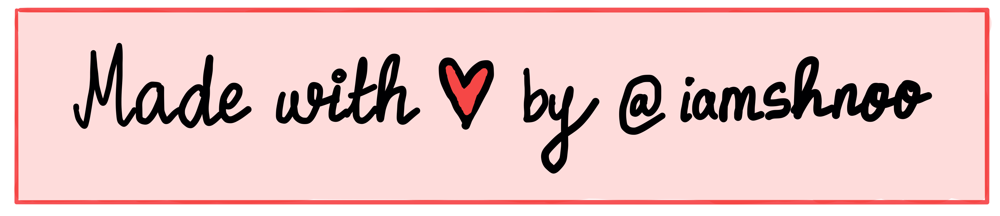

  

<h1 align="center">
  Hi , I'm Anjishnu Mukherjee (shnoo)
</h1>

PhD candidate at George Mason University · multilingual and multicultural NLP · LLMs · low-resource languages · bias and fairness

  

<h3 align="center">📚 Some recent papers</h3>

<table>
<tr>
<td width="50%" valign="top" align="center">
 
<a href="https://iamshnoo.github.io/double_trouble/"><b>Double Trouble</b></a> 
Bilingual pretraining leaves language-conditioned effects in shared-language representations 
<b>EMNLP 2026</b> · 🏆 Outstanding Paper
</td>
<td width="50%" valign="top" align="center">
 
<a href="https://iamshnoo.github.io/metadata_localization/"><b>MAPLE</b></a> 
Metadata-conditioned LLM pretraining for locale-aware question answering 
<b>EMNLP 2026</b> · 🎤 Oral
</td>
</tr>
<tr>
<td width="50%" valign="top" align="center">
 
<a href="https://iamshnoo.github.io/tower_of_babel/"><b>Lost in the Tower of Babel</b></a> 
The adverse effects of incidental multilingualism in LLMs 
<b>COLM 2026</b>
</td>
<td width="50%" valign="top" align="center">
 
<a href="https://iamshnoo.github.io/crossroads_wacv_25/"><b>Crossroads of Continents</b></a> 
Automated artifact extraction for cultural adaptation with large multimodal models 
<b>WACV 2025</b>
</td>
</tr>
<tr>
<td width="50%" valign="top" align="center">
 
<a href="https://iamshnoo.github.io/global_gallery/"><b>Global Gallery</b></a> 
Painting culture portraits through multilingual instruction tuning 
<b>NAACL 2024</b>
</td>
<td width="50%" valign="top" align="center">
 
<a href="https://iamshnoo.github.io/breaking_bias_building_bridges/"><b>Breaking Bias, Building Bridges</b></a> 
Evaluating and mitigating social biases in LLMs via the contact hypothesis 
<b>AIES 2024</b>
</td>
</tr>
<tr>
<td width="50%" valign="top" align="center">
 
<a href="https://iamshnoo.github.io/global_voices_local_biases/"><b>Global Voices, Local Biases</b></a> 
Socio-cultural prejudices across languages 
<b>EMNLP 2023</b>
</td>
<td width="50%"></td>
</tr>
</table>

All papers on <a href="https://scholar.google.com/citations?user=3849YpIAAAAJ&hl=en">Google Scholar</a> · <a href="https://www.semanticscholar.org/author/2125631153">Semantic Scholar</a> · <a href="https://aclanthology.org/people/anjishnu-mukherjee/">ACL Anthology</a> · <a href="https://dblp.org/pid/339/6660">DBLP</a> · datasets and models on <a href="https://huggingface.co/iamshnoo">🤗 Hugging Face</a>

- 🔭 My research is on multilingual and multicultural LLMs, low-resource languages, and bias and fairness in NLP.
- 💻 Before my PhD, I was a [Google Summer of Code](https://summerofcode.withgoogle.com/) student with [mlpack](https://github.com/mlpack) and joined its core contributors team ([mlpack 4, JOSS 2023](https://joss.theoj.org/papers/10.21105/joss.05026)).
- 📝 All my papers, talks, and CV are on [my homepage](https://iamshnoo.github.io/).
- 😄 Pronouns: he/him

<h3 align="center">🛠️ Tools I use</h3>

  

