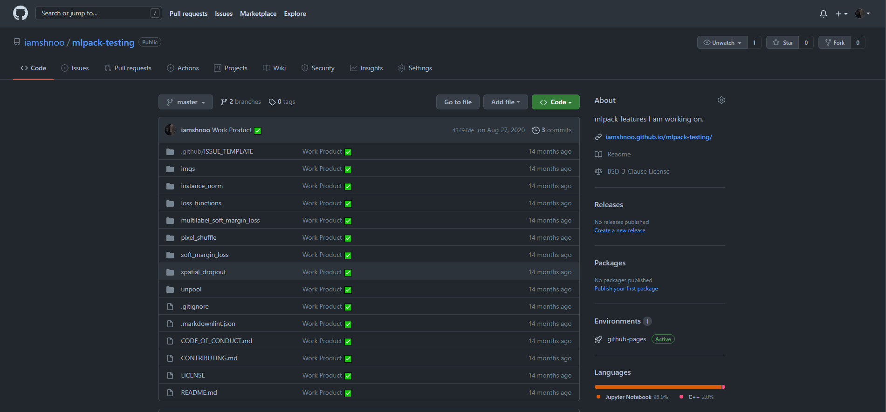

# Anjishnu Mukherjee (shnoo)

PhD candidate at George Mason University. Multilingual and multicultural NLP, LLMs, low-resource languages, bias and fairness.

My [homepage](https://iamshnoo.github.io/) has my papers, code, datasets, talks, and CV.

## Selected papers

- [Double Trouble: Bilingual Pretraining Leaves Language-Conditioned Effects in Shared-Language Representations](https://iamshnoo.github.io/double_trouble/). EMNLP 2026, Outstanding Paper Award. Code: [bli](https://github.com/iamshnoo/bli)
- [MAPLE: Metadata Conditioned LLM Pretraining for Locale-Aware Question Answering](https://iamshnoo.github.io/metadata_localization/). EMNLP 2026, oral. Code: [metadata_localization](https://github.com/iamshnoo/metadata_localization)
- [Lost in the Tower of Babel: The Adverse Effects of Incidental Multilingualism in LLMs](https://iamshnoo.github.io/tower_of_babel/). COLM 2026.
- [Crossroads of Continents: Automated Artifact Extraction for Cultural Adaptation with Large Multimodal Models](https://iamshnoo.github.io/crossroads_wacv_25/). WACV 2025. Code: [crossroads](https://github.com/iamshnoo/crossroads)
- [Global Gallery: The Fine Art of Painting Culture Portraits through Multilingual Instruction Tuning](https://iamshnoo.github.io/global_gallery/). NAACL 2024. Code: [culture-llm](https://github.com/iamshnoo/culture-llm)
- [Breaking Bias, Building Bridges: Evaluation and Mitigation of Social Biases in LLMs via Contact Hypothesis](https://iamshnoo.github.io/breaking_bias_building_bridges/). AIES 2024, co-first author with Chahat Raj.
- [Global Voices, Local Biases: Socio-cultural Prejudices across Languages](https://iamshnoo.github.io/global_voices_local_biases/). EMNLP 2023, co-first author with Chahat Raj. Code and data: [weathub](https://github.com/iamshnoo/weathub)

The full list is on [Google Scholar](https://scholar.google.com/citations?user=3849YpIAAAAJ&hl=en), [Semantic Scholar](https://www.semanticscholar.org/author/2125631153), the [ACL Anthology](https://aclanthology.org/people/anjishnu-mukherjee/), and [DBLP](https://dblp.org/pid/339/6660). Datasets and models are on [Hugging Face](https://huggingface.co/iamshnoo). ORCID: [0000-0003-4012-8466](https://orcid.org/0000-0003-4012-8466).

## Earlier work

- I have previously [worked](https://github.com/iamshnoo/mlpack-testing)
  with [mlpack](https://github.com/mlpack) as a
  [Google Summer of Code](https://summerofcode.withgoogle.com/) student.
  I am part of the core mlpack Contributors team.

  

  
  

  

- I have also worked with the
  [Computer Graphics and Virtual Reality Research Lab](https://cgvr.cs.uni-bremen.de/)
  on research regarding continuous collision detection.

- I even have a couple of
  [papers](https://www.researchgate.net/profile/Anjishnu-Mukherjee) with
  researchers from MIT and University of Toronto regarding applications of deep
  learning methods to clinical procedures
  that help in early detection of cancer.

- I write articles on [https://iamshnoo.github.io/blog/](https://iamshnoo.github.io/blog/)

- Pronouns: [he/him](http://pronoun.is/he)

## Connect with me

[X](https://x.com/iamshnoo) · [LinkedIn](https://linkedin.com/in/anjishnumukherjee) · [Stack Overflow](https://stackoverflow.com/users/11009359)

